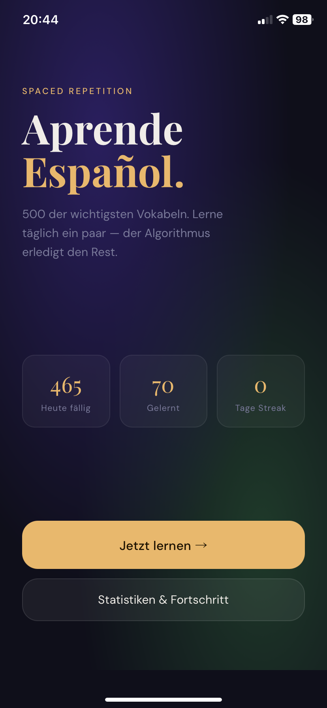
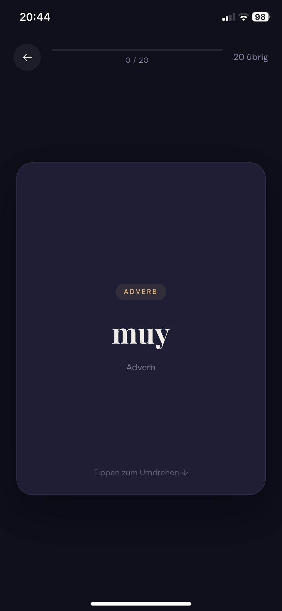
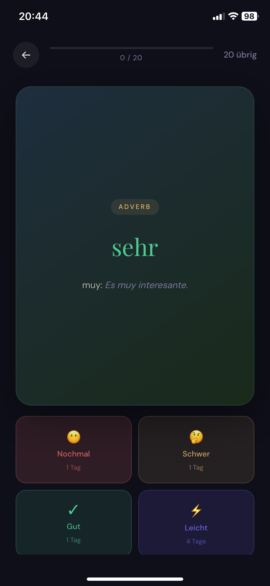

# Español Flashcards

Eine progressive Web App (PWA) zum Lernen spanischer Vokabeln mit wissenschaftlich fundiertem Spaced Repetition System.

## 📸 Screenshots

  

## 🎯 Was ist das?

Eine iPhone- und Browser-freundliche Flashcard-App mit **500 der häufigsten spanischen Wörter** für Anfänger (A1/A2-Niveau). Basierend auf dem bewährten SM-2-Algorithmus — derselben Technologie wie Anki.

**Kernfeatures:**
- ✅ Spaced Repetition (SRS) — intelligente Wiederholungen
- 🇪🇸 500 kuratierte Vokabeln mit deutschen Übersetzungen und Beispielsätzen
- 📱 Läuft offline — Daten speichern sich lokal
- 🎨 Fokussiertes, mobiles Design (besonders gut auf iPhone)
- 📊 Fortschrittsanzeige und Statistiken
- 🚀 Kostenlos und open source

## 🚀 Schnelleinstieg

### Im Browser (Desktop/Tablet)
1. `spanisch-flashcards.html` herunterladen oder öffnen
2. Zum Lernen einfach öffnen — alle Daten bleiben lokal

### Auf dem iPhone (als App)
1. `spanisch-flashcards.html` öffnen (z.B. als Link auf GitHub Pages)
2. Safari-Teilen-Button → **Zum Home-Bildschirm**
3. App öffnet sich wie eine native App (ohne Browser-UI)

## 📚 Wie funktioniert's?

### Die Lernmethode
1. **Flashcard anschauen:** Spanisches Wort auf der Vorderseite
2. **Überlegen:** Was bedeutet das Wort?
3. **Umdrehen (tippen):** Deutsche Übersetzung + Beispielsatz
4. **Bewerten:** Nochmal / Schwer / Gut / Leicht

Der Algorithmus merkt sich deine Antworten und zeigt dir Karten in intelligenten Intervallen:
- **Nochmal:** <1 Minute
- **Schwer:** 1 Tag
- **Gut:** 3 Tage
- **Leicht:** 7 Tage

Je besser du eine Karte kennst, desto seltener siehst du sie.

### Lernsession
- 20 Karten pro Sitzung (optimiert für tägliche 5–10 Minuten)
- Lerne täglich — **Kontinuität schlägt Intensität**
- Dein Fortschritt wird automatisch gespeichert

## 📊 Vokabelkategorien

Die 500 Wörter sind organisiert in:
- **Verben** (sein, haben, gehen, sprechen, etc.)
- **Nomen** (Menschen, Orte, Dinge, Essen)
- **Adjektive** (groß, klein, gut, schlecht, etc.)
- **Pronomen** (ich, du, er, sie, etc.)
- **Zeit** (Tage, Monate, Zeitausdrücke)
- **Phrasen** (Begrüßungen, höfliche Ausdrücke)
- **Zahlen, Körper, Transport, Natur, Abstrakt**

Jede Karte enthält:
- Spanisches Wort
- Deutsche Übersetzung
- Wortart (Kategorie)
- Beispielsatz im Kontext

## 🔧 Technische Details

**Stack:**
- Vanilla HTML, CSS, JavaScript — keine Dependencies
- Spaced Repetition Engine (SM-2-Algorithmus)
- localStorage für persistente Datenspeicherung
- Service Worker für Offline-Funktionalität

**Browser-Kompatibilität:**
- Chrome, Safari (iOS 12+), Firefox
- PWA-fähig (installierbar auf Home-Bildschirm)

## 💾 Daten & Datenschutz

- **Alle Daten werden lokal gespeichert** — auf deinem Gerät, nirgendwo sonst
- Keine Verfolgung, keine Konten, kein Internet nötig (nach dem Laden)
- Du kannst deine Daten jederzeit löschen (Button in der Stats-Seite)

## 🎓 Wissenschaftlicher Hintergrund

Diese App basiert auf bewährter Forschung:

1. **Ebbinghaus Forgetting Curve**: Wir vergessen neues Wissen exponentiell schnell — Spaced Repetition ist der beste Gegenmittel
2. **Testing Effect**: Aktives Abrufen (du versuchst zu erinnern) ist stärker als passives Lesen
3. **Krashen's Input Hypothesis**: Wörter im Kontext (mit Beispielsätzen) werden besser gelernt als isoliert

**Empfehlungen für maximale Effektivität:**
- Nutze die App täglich — 20 Minuten reichen
- Nach 2–3 Wochen: Kombiniere mit **comprehensible input** (Podcasts, einfache Videos auf Spanisch)
- Achte auf echte Sätze und Kontexte, nicht nur Einzelwörter

## 🛠️ Entwicklung

### Lokal testen
```bash
# Einfach die HTML-Datei im Browser öffnen
open spanisch-flashcards.html  # macOS
start spanisch-flashcards.html # Windows
```

### Mit GitHub Pages deployen
1. Repository zu GitHub pushen
2. Settings → Pages → Source: `main`
3. App verfügbar unter: `username.github.io/spanisch-flashcards`

### Erweiterungsmöglichkeiten
- [ ] Aussprache (Audio-Dateien)
- [ ] Sprechübungen (Mikrofon-Input)
- [ ] Sync über Cloud (optional)
- [ ] Satz-basiertes Lernen statt nur Wörter
- [ ] Kategorie-Filter (nur Verben lernen, etc.)
- [ ] Export/Import der Fortschritte

## 📝 Lizenz

Open Source — nutze, modifiziere und teile frei.

## 🤝 Beitragen

Verbesserungen und Fehlerberichte sind willkommen:
- Bug gefunden? → Issues erstellen
- Ideen? → Discussions oder Pull Request
- Neue Vokabeln? → Gerne, mit Beispielsätzen

## 🎯 Roadmap

**Kurzfristig:**
- Fehlerberichte beheben
- UX basierend auf Feedback verbessern

**Langfristig:**
- Satz-basiertes Lernformat (statt nur Wörter)
- Thematische Gruppierung (Restaurant, Familie, Arbeit, etc.)
- Integration mit Text-to-Speech für Aussprache

---

**Viel Erfolg beim Lernen! 🎉 Regelmäßigkeit ist wichtiger als Perfektion.**

> "The best language learning app is the one you use every day." — Nobody, but it's true.
